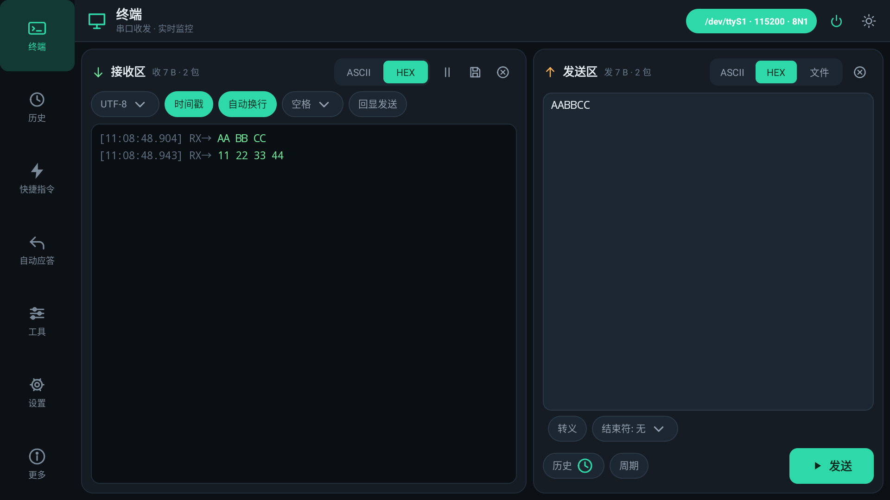
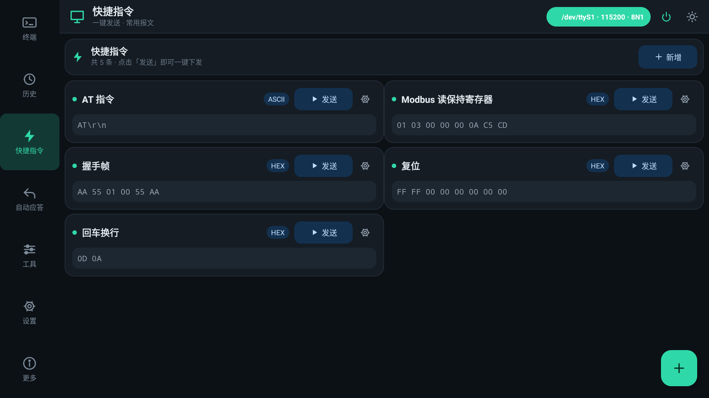
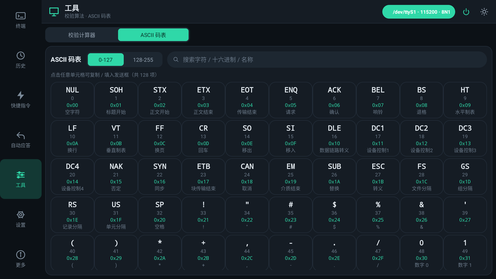
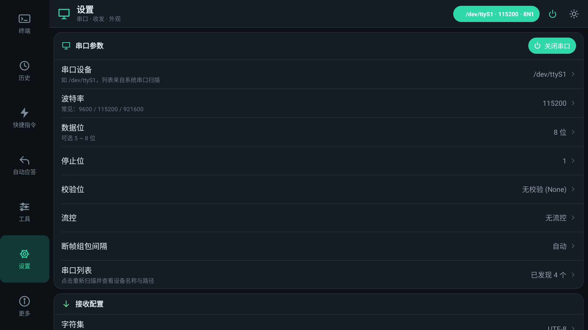
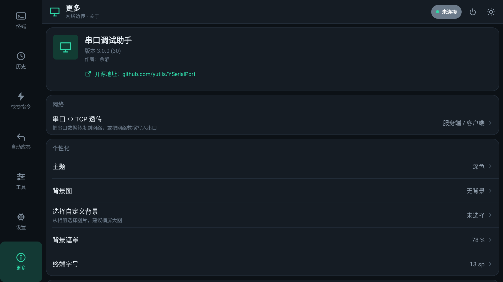

# YSerialPort

**简体中文** | [English](README_en.MD)

源Android-SerialPort-API，重新封装代码，实现读取串口数据，实现重新组包一次性读取完整数据。可连续读取任意长度数据。

重写串口so库名称和调用函数名称，不与其他串口工具形成so冲突或者类名冲突。

已经多次长时间测试：串口打印机，PLC通信，串口电子秤，串口条码读卡器，串口二维码读卡器，串口LED屏，串口NFC读卡器，读M1区一次性读取64个扇区，读CPU区一次读取16KB数据。

理论上兼容 安卓4.4~安卓14.0+

demo这个APK 2.2.7 - 2.2.9 安卓4.4（API），2.3.0+ 安卓6.0+ （API23）
引用这个lib 只需要 API19+

[](https://developer.android.google.cn/studio/index.html)

[](https://github.com/yutils/YSerialPort/commits/master)


[](https://search.maven.org/artifact/com.kotlinx/yserialport)

**[releases里面有APK文件。点击前往](https://github.com/yutils/YSerialPort/releases)**

**[releases里面有AAR包。点击前往](https://github.com/yutils/YSerialPort/releases)**

**如果拉取整个项目，请用最新AS（AS2026.2.1以上）打开**

## Gradle采用java17

### 设置方法： Project Structure ----> SDK Location ----> JDK location was moved to Gradle Settings. ---->  Gradle JDK ---->  JDK17

## 引用

### [添加依赖，当前最新版：————> 2.3.0　　　　](https://search.maven.org/artifact/com.kotlinx/yserialport)

```
dependencies {
    //更新地址  https://github.com/yutils/YSerialPort 建议过几天访问看下有没有新版本
    implementation 'com.kotlinx:yserialport:2.3.0'
}
```

注：如果引用失败，看下面方案
```
allprojects {
    repositories {
        google()
        //mavenCentral()
        
        //如果还是不容易拉取,可以试试直接用maven.org
        maven { url 'https://repo1.maven.org/maven2' }
    }
```
---

# v2.3.0 · 演示 App 全量 UI 重构

`app` 模块已使用 Kotlin + ViewBinding 完全重写（Material 3 设计语言），**横屏工控优先、竖屏自动适配**。

### 界面结构

| 页面 | 说明 |
| --- | --- |
| 终端 | 收发一体：接收区（ASCII/HEX、字符集、时间戳、自动换行、2 万字符上限、长按复制）+ 发送区（ASCII/HEX/文件、转义字符、结束符、周期发送） |
| 历史 | 收发记录检索 / 筛选 / 搜索 / 复制 / 回填发送框 / 导出文件 |
| 快捷指令 | 快捷指令增删改、HEX/ASCII 类型、一键发送 |
| 自动应答 | 自动应答规则（包含/相等/前缀/后缀/正则，HEX 支持 `??` 通配）、延时、仅应答一次 |
| 工具 | 校验算法计算器（31 种 CRC + SUM/XOR/LRC/BCC/Fletcher/Adler，可调高低字节序、输入/输出反转、异或、取反、位宽）+ ASCII 码表（0–255，可复制/发送） |
| 设置 | 串口全参数（串口/波特率/数据位/停止位/校验位/流控/断帧间隔）、接收配置、发送配置、外观（主题/背景图/字号/常亮） |
| 更多 | 串口 ↔ TCP 透传（服务端/客户端）、主题切换、内置/自定义背景图、导出记录、恢复默认、开源地址（可复制/跳转）、退出应用 |

### 截图






### 自适应布局

- 横屏：左侧竖向导航栏 + 右侧多列内容（终端页接收/发送左右分栏）
- 竖屏：顶部状态栏 + 单列内容 + 底部横向导航（终端页接收/发送上下分栏）
- 分栏容器按自身宽高比自动切换方向，旋转无需重建 Activity

### 其他

- 深色工业风为默认主题，支持浅色主题切换与「跟随系统」
- 内置 AI 生成的电路板壁纸，支持从相册自定义背景图并调节遮罩
- 壁纸遮蔽度、终端字号、历史条数等均可配置，配置持久化

设计文档见 [`docs/REFACTOR_PLAN.md`](docs/REFACTOR_PLAN.md)，测试截图见 [`docs/screenshots`](docs/screenshots)。

### 构建与代码质量

- 依赖版本按本地 Gradle 缓存锁定，支持 `./gradlew --offline` 完全离线构建
- 发布包开启 `minifyEnabled` + `shrinkResources`，release APK 约 2.8 MB
- 已通过 Android Lint 清理（无用资源 125 项、编译告警 0 条）；有意保留的检查项在 [`app/lint.xml`](app/lint.xml) 中注明原因
- 调试脚本：[`docs/tools/t.sh`](docs/tools/t.sh)（ADB 点击/截图/控件定位）、[`docs/crc_check.py`](docs/crc_check.py)（CRC 预设与 reveng 标准值交叉验证）

---

## 库增强（v2.3.0，向后兼容）

`yserialport` 新增增强串口入口，**原有 API 行为完全不变**：

```java
SerialPort serialPort = SerialPort.newBuilder(new File("/dev/ttyS1"), 115200)
        .dataBits(8)          // 5 ~ 8
        .parity(0)            // 0:NONE 1:ODD 2:EVEN 3:MARK 4:SPACE
        .stopBits(1)          // 1:1位 2:2位 3:1.5位（需 5 位数据位）
        .flowControl(0)       // 0:无 1:硬件RTS/CTS 2:软件XON/XOFF  ← 新增
        .build();
serialPort.flushBuffers();    // 新增：清空收发缓冲
```

> 仅当使用到扩展参数（流控 / MARK / SPACE / 1.5 停止位）时才走新的 JNI 入口 `openEx`，其余情况仍走原有 `open`，保证兼容性。

---


# 使用方法

可以参考 `app` 模块中的实现：串口收发封装见 [`core/serial/SerialManager.kt`](app/src/main/java/com/yujing/chuankou/core/serial/SerialManager.kt)，界面见 [`ui/terminal/TerminalFragment.kt`](app/src/main/java/com/yujing/chuankou/ui/terminal/TerminalFragment.kt)

## 基础使用方法

```java
YSerialPort ySerialPort = new YSerialPort(this, "/dev/ttyS4", "9600");
//设置数据监听
ySerialPort.addDataListener(new DataListener() {
    @Override
    public void value(String hexString, byte[] bytes) {
        //结果回调：hexString , bytes
    }
});
ySerialPort.start();
```

## 扩展使用方法

**java**  

**同步** 

```java
//拿流用法，自己通过流收发数据
SerialPort serialPort = SerialPort.newBuilder(new File("/dev/ttyS4"), 9600)
        .parity(0) // 校验位；0:无校验位(NONE，默认)；1:奇校验位(ODD);2:偶校验位(EVEN)
        .dataBits(8) // 数据位,默认8；可选值为5~8
        .stopBits(1) // 停止位，默认1；1:1位停止位；2:2位停止位
        .build();
serialPort.getInputStream();//获取输入流
serialPort.getOutputStream();//获取输出流
serialPort.tryClose();//关闭
```

```java
//同步收发 （不用每次都创建serialPort对象）
SerialPort serialPort=SerialPort.newBuilder(new File("/dev/ttyS4"),9600).build();
byte[] bytes=YSerialPort.sendSyncOnce(serialPort,sendBytes,1000);
byte[] bytes=YSerialPort.sendSyncTime(serialPort,sendBytes,20,1000);
byte[] bytes=YSerialPort.sendSyncLength(serialPort,sendBytes,20,1000);
serialPort.tryClose();//关闭

//不持有serialPort对象的用法（内部开、关串口）
//发送并等待返回，死等
byte[] bytes=YSerialPort.sendSyncOnce("/dev/ttyS4","9600",bytes);
//发送并等待返回，直到超时，如果超时则向上抛异常
byte[] bytes=YSerialPort.sendSyncOnce("/dev/ttyS4","9600",bytes,500);
//一直不停组包，（maxGroupTime每次组包时间）当在maxGroupTime时间内没有数据，就返回并关闭连接
byte[] bytes=YSerialPort.sendSyncTime("/dev/ttyS4","9600",bytes,500);
//一直不停组包，（maxGroupTime每次组包时间）当在maxGroupTime时间内没有数据，就返回并关闭连接（如果一直有数据，最多接收时间为maxTime）
byte[] bytes=YSerialPort.sendSyncTime("/dev/ttyS4","9600",bytes,500,3000);
//一直不停组包，当数据长度达到minLength或超时，返回并关闭连接
byte[] bytes=YSerialPort.sendSyncLength("/dev/ttyS4","9600",bytes,500,3000);

```

**异步**

```java

//String[] device = YSerialPort.getDevices();//获取串口列表
//String[] baudRate = YSerialPort.getBaudRates();//获取波特率列表

//YSerialPort.saveDevice(getApplication(), "/dev/ttyS4");//设置默认串口,可以不设置
//String device=YSerialPort.readDevice(getApplication());//获取上面设置的串口

//YSerialPort.saveBaudRate(getApplication(), "9600");//设置默认波特率,可以不设置
//String baudRate=YSerialPort.readBaudRate(getApplication());//获取上面设置的波特率

//异步收发
YSerialPort ySerialPort=new YSerialPort(this,"/dev/ttyS4","9600");
//设置数据监听
ySerialPort.addDataListener(new DataListener() {
    @Override
    public void value(String hexString, byte[] bytes) {
        //结果回调：hexString , bytes
    }
});
//设置回调线程为主线程，默认主线程
ySerialPort.setThreadMode(ThreadMode.MAIN);
//设置自动组包，每次组包时长为40毫秒，如果40毫秒读取不到数据则返回结果
ySerialPort.setToAuto(); //ySerialPort.setToAuto(40);
//或者,设置手动组包，读取长度100，超时时间为50毫秒。如果读取到数据大于等于100立即返回，否则直到读取到超时为止
//ySerialPort.setToManual(100,50);
//启动
ySerialPort.start();
//发送文字
ySerialPort.send("你好".getBytes(Charset.forName("GB18030")));

//退出页面时候注销
@Override
protected void onDestroy(){
    super.onDestroy();
    ySerialPort.onDestroy();
}

//如果要自己解析inputStream，请在start()之前实现此方法
ySerialPort.setInputStreamReadListener(inputStream->{
    int count=0;
    while(count==0)
        count=inputStream.available();
    byte[]bytes=new byte[count];
    //readCount，已经成功读取的字节的个数，这儿需读取count个数据，不够则循环读取，如果采用inputStream.read(bytes);可能读不完
    int readCount=0;
    while(readCount<count)
        readCount+=inputStream.read(bytes,readCount,count-readCount);
    return bytes;
});
```


**kotlin**

```kotlin
//创建对象
val ySerialPort = YSerialPort(this, "/dev/ttyS4", "9600")
//设置数据监听
ySerialPort.addDataListener { hexString, bytes ->
    //结果回调：hexString , bytes
}
//设置自动组包，每次组包时长为40毫秒，如果40毫秒读取不到数据则返回结果
ySerialPort.setToAuto() //ySerialPort.setToAuto(40)
//或者,设置手动组包，读取长度100，超时时间为50毫秒。如果读取到数据大于等于100立即返回，否则直到读取到超时为止
//ySerialPort.setToManual(100,50)
//启动
ySerialPort.start()

//发送文字
ySerialPort.send("你好".toByteArray(Charset.forName("GB18030")))

//退出页面时候注销
override fun onDestroy() {
    super.onDestroy()
    ySerialPort.onDestroy()
}
```

## 代码混淆
```
-keepclasseswithmembernames class * {
    native <methods>;
}
#-keep class com.yujing.** { *; }
-keep class com.yujing.serialport.* { *; }
-keep class com.yujing.yserialport.* { *; }
```

## 根据协议头组包完整示例

```kotlin
//原理就是准备一个字符串，每次都数据都拼接到后面，然后判断协议头是否正确？（对了就取对应长度数据然后剪掉用过的数据长度）:（如果不对就剪掉协议头数据，重新开始）
class Test {
    var ySerialPort: YSerialPort? = null

    //log
    var showLog = false

    //最后一次组包剩余数据
    private var oldSurplus = ""

    fun test() {
        ySerialPort = YSerialPort(context, "/dev/ttyS2", "9600")
        ySerialPort?.addDataListener { hexString, bytes ->
            dataFilter(hexString)
        }
        ySerialPort?.start()
    }

    //拆包组包，举例：数据包：02 2B 30 30 30 30 30 30 30 31 42 03  //其中：协议头 02  2B正2D负   6位重量  1位小数点位数  2位校验(2B到30) 03结束位
    @Synchronized
    fun dataFilter(hexStr: String) {
        //先组装上一次剩余数据
        oldSurplus += hexStr.replace(" ", "")
        if (oldSurplus.isEmpty()) return

        //定义一个包长度
        var dataLength = 24

        //判断长度
        if (oldSurplus.length < dataLength) {
            if (showLog) YLog.d("数据长度不够，等一手！$oldSurplus")
            return
        }

        //验证协议头，非02开头就抛弃
        if (oldSurplus.substring(0, 2) != "02") {
            if (showLog) YLog.d("数据异常，抛弃数据头！$oldSurplus")
            //剪掉数据头，如果剩余数据大于一个完整包，递归一次
            oldSurplus = oldSurplus.substring(2)
            if (oldSurplus.length >= dataLength)
                dataFilter("")
            return
        }
        //如果有数据长度位，获取长度位+包头+包尾=包长，dataLength重新赋值新的包长
        //dataLength=数据长度+包头+包尾

        //验证协议尾，同上

        
        //验证校验码
        //......

        //获取数据处理 【这儿就是一个完整的数据包！】 【这儿就是一个完整的数据包！】 【这儿就是一个完整的数据包！】 
        handle(YConvert.hexStringToByte(oldSurplus.substring(0, dataLength)))

        //剪去用过的数据
        oldSurplus = oldSurplus.substring(dataLength)

        //剩余数据可能还能有完整包。所以递归一次
        if (oldSurplus.length >= dataLength)
            dataFilter("")
    }
    
    //处理数据。dataByteArray的长度应该是8
    private fun handle(dataByteArray: ByteArray) {
        //处理分析，转换成对象obj
        //.....

        //通知前端
        //YBusUtil.post("某某设备发送的数据", obj)
    }
    
    //退出页面时候注销
    fun onDestroy() {
        ySerialPort?.onDestroy()
    }
}
```

串口文件位置：/proc/tty/drivers

感谢：[Android-SerialPort-API](https://github.com/licheedev/Android-SerialPort-API)

不懂的问我QQ：3373217 （别问为啥手机没串口，别问模拟器怎么调试串口(可以映射)，别问USB转的串口为什么不能识别）

如果是USB转串口，请参考这个工程：

[CH340/CH341的USB转串口](https://github.com/yutils/CH34xUART)

---

**简体中文** | [English](README_en.MD)


